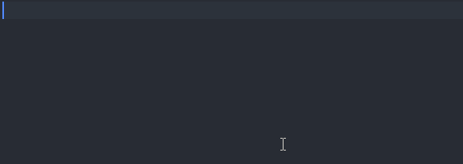

# Rainbow Brackets 2

Multi-color highlight of matching brackets.

This fork is the continuation of original [Rainbow Brackets](https://github.com/gastrodia/rainbow-brackets).

## Features

* Round, square and squiggly brackets each have their own colors, one for each level of nesting.
* Closing brackets without an opening bracket are red.
* Brackets in strings, comments and regular expressions are left alone. They are found with the syntax highlighting grammar of the language, the same way VS Code's own bracket pair colorization finds them, so this works in every language that VS Code highlights.
* Large files are scanned in the background, and only the brackets around the visible lines are decorated.

VS Code's own bracket pair colorization (`editor.bracketPairColorization.enabled`) can stay on. The colors of this extension are drawn over it.

## Extension Settings

Settings under _Rainbow Brackets 2_ section can be used to:

* Provide custom colors, as many as you like for each kind of bracket.
* Exclude specific filetypes.
* Color brackets in strings and comments too (`rainbowBrackets.ignoreStringsAndComments`).
